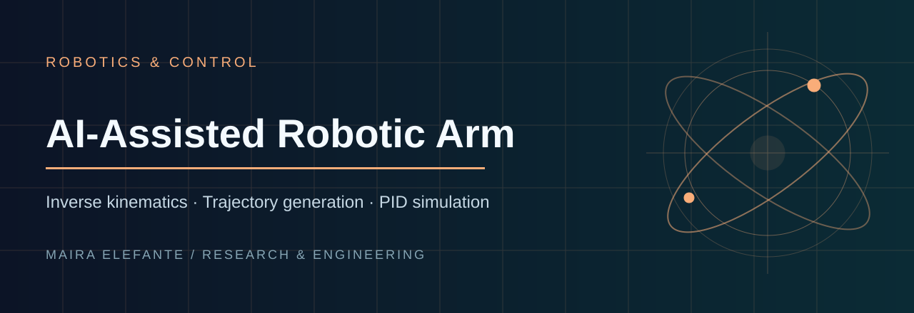

> **Inverse kinematics · Trajectory generation · PID simulation**

**Focus:** Robotics & Control · [Source and project files](./)

---

# AI-Assisted Robotic Arm & Mechatronic Control Simulation

A compact robotics/mechatronics portfolio project that models a planar two-link robotic arm and demonstrates an end-to-end engineering workflow: inverse kinematics, trajectory generation, closed-loop PID control, noisy joint sensing, tracking-fault detection, testing, and technical documentation.

## Why this project exists

The project is designed to demonstrate how an AI coding agent can support a multi-file engineering task while the engineer remains responsible for requirements, physical assumptions, validation, debugging, and final verification. It is a simulation project, not a claim of physical-robot deployment.

## Features

- Analytical forward and inverse kinematics for a 2-DOF arm
- Reachability validation for Cartesian targets
- Smooth joint-space target generation
- Independent PID joint controllers with saturation and anti-windup limits
- Simplified joint dynamics with inertia, damping, and velocity limits
- Reproducible noisy sensor measurements
- Tracking-error fault flags
- Cartesian trajectory and joint-response plots
- Automated tests for kinematics, control limits, and end-to-end convergence

## Project structure

```text
.
├── main.py
├── requirements.txt
├── src/
│   ├── control.py
│   ├── kinematics.py
│   ├── sensors.py
│   └── simulation.py
├── tests/
│   ├── test_control.py
│   ├── test_kinematics.py
│   └── test_simulation.py
└── docs/
    └── AI_AGENT_WORKFLOW.md
```

## Run locally

```bash
python -m venv .venv
```

Windows:

```bash
.venv\Scripts\activate
pip install -r requirements.txt
python main.py
pytest -q
```

Linux/macOS:

```bash
source .venv/bin/activate
pip install -r requirements.txt
python main.py
pytest -q
```

Run without plots:

```bash
python main.py --no-plot
```

Try another reachable target:

```bash
python main.py --x 0.9 --y 1.1
```

## Engineering assumptions

This is intentionally a lightweight model. Each joint uses a normalized inertia and viscous damping rather than a full rigid-body dynamics model. The objective is to make the software/control workflow easy to inspect and test. A production robot would require actuator models, coupled dynamics, calibrated sensors, safety constraints, collision handling, hardware interfaces, and real-time considerations.

## AI-agent workflow

The repository includes `docs/AI_AGENT_WORKFLOW.md`, which describes how to document AI-assisted implementation honestly: task definition, agent instructions, generated changes, failures, human review, tests, and final verification.

## Suggested next extensions

- Add joint limits and singularity diagnostics
- Inject encoder bias or a stuck-sensor fault at runtime
- Add a state-machine safety layer
- Compare PID gains and quantitative settling metrics
- Port the controller core to C++
- Add ROS 2 integration only after the standalone model is validated

## License

MIT
